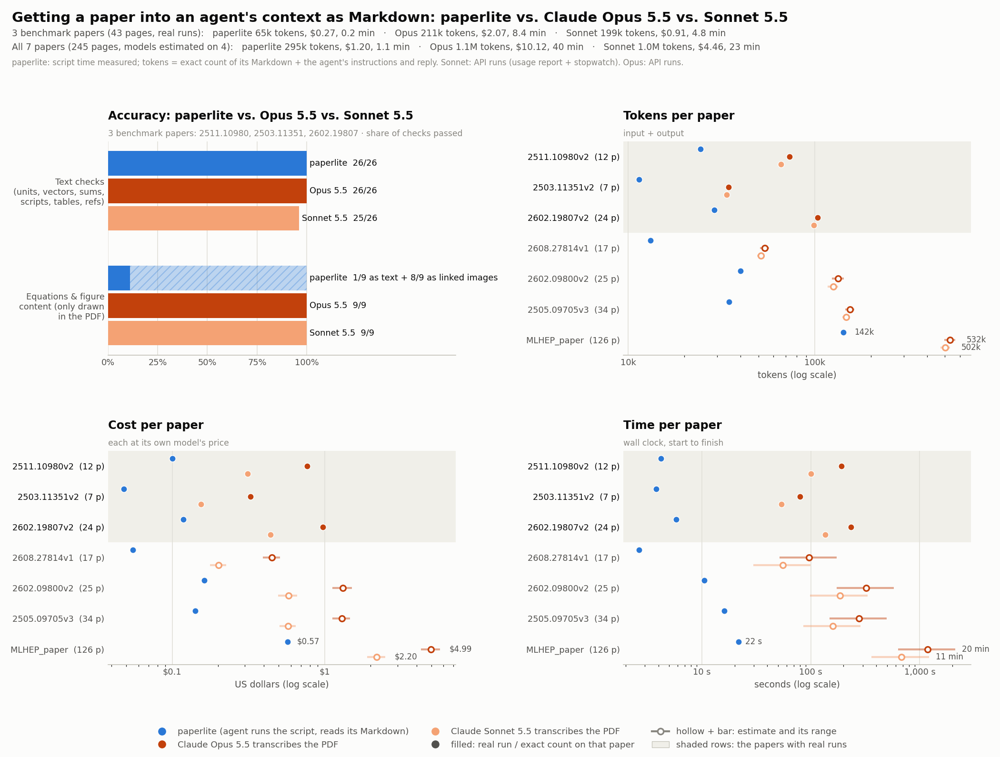

# Reading published papers: what the agent digests

The analysis policy asks the agent to follow the variables and selection of a
published analysis. With `read_paper` and `view_figure` it reads the paper
itself instead of only the curated summaries in `docs/references.md`. A PDF
the student puts in `data/papers/` is converted once by `agent/paperlite`
(PyMuPDF, no API call) into Markdown, an `index.json` and figure, table and
equation crops. The agent then reads that conversion in small pieces.

This page shows what the agent receives, call by call, on six Belle II
papers, and where the approach works and where it does not. Everything here
can be reproduced without an API call:

```bash
scripts/fetch_test_papers.sh                                  # the six PDFs -> data/papers/
python scripts/show_agent_view.py                             # size table
python scripts/show_agent_view.py 2602.09800v2 --next --figure "Eq. (5)" --save
python tests/test_paper_agent_view.py -v                      # what the agent sees, pinned
python tests/test_paperlite_benchmarks.py -v                  # converter accuracy checks
```

## One paper, call by call

The example is the B⁺ → µ⁺ν paper (arXiv:2602.09800, 25 pages, revtex).

**1. `read_paper()`**: which papers are available.

```
Papers in data/papers/:
- 2602.09800v2.pdf: Study of B^{+} → µ^{+}ν_{µ} decays at Belle and Belle II
- ...
```

**2. `read_paper("2602.09800v2")`**: the short first view (15k chars,
~3.8k tokens). It holds the outline, where the selection is stated, the figure
and table list, and the abstract and conclusion. Excerpt:

```
Sections ([shown] / [partly shown] / [method, ask by name] / ...):
- (front matter: abstract) (p1, 1,985 chars) [shown]
- I. INTRODUCTION (p2, 5,582 chars) [ask by name]
- II. DETECTOR, SIMULATED SAMPLES AND CORRECTIONS (p3, 50 chars) [details, ask by name]
- III. EVENT SELECTION (p6, 23 chars) [method, ask by name]
  - A. Signal and Tag-side Reconstruction (p6, 3,923 chars) [method, ask by name]
  ...
- X. SUMMARY AND CONCLUSION (p18, 4,059 chars) [shown]

Where the selection is stated (pattern-matched; verify values in the paper):
- variables cut on: p_{µ}^{B}, m_{N}, E_{γ}^{B}, p_{µ}^{*}, θ, P_{µ}, |dz|, p_{T}, |t_{cluster}|, ...
- requirements: 2.1 GeV < p_{µ}^{*} < 3.4 GeV (p6); 17° < θ < 150° (p6); P_{µ} > 0.99 (p6);
  |dz| < 2 cm (p6); p_{T} > 100 MeV (p6); |t_{cluster}| < 200 ns (p6); θ_{thrust} < 0.8 (p9); ...
- selection/variable tables: Table III (p10); Table IV (p11); Table VI (p24)

Next (selection, signal, backgrounds, fit, systematics): read_paper(name, section='III. EVENT
SELECTION; V. STATISTICAL ANALYSIS AND LIMIT SETTING PROCEDURE; VI. SYSTEMATIC UNCERTAINTIES')
Details (samples, simulation, method, inputs, training): read_paper(name, section='II. DETECTOR,
SIMULATED SAMPLES AND CORRECTIONS; IV. VALIDATION USING B^{+} → D̄^{0}π^{+} DECAYS')
```

**3. The suggested `section=` call**: the method sections the plan needs
(23.7k chars, ~5.9k tokens), with their subsections. Introduction, detector
description, acknowledgements, references and appendices are never sent
unless asked for by name.

**4. `view_figure("2602.09800v2", "Eq. (5)")`**: only when the text is not
enough. The extracted text of this display equation is out of order:

```
Equation (5): ∑ /  / (5) / p_{tag}^{lab} = / p^{lab} +_{i} ∑ _{j} p^{lab}, / j ∈ γ / i ∈charged
```

The image block returned with it (a 692 × 77 px crop) shows the agent the
actual equation, p⃗_tag^lab = Σ_{i∈charged} p⃗_i^lab + Σ_{j∈γ} p⃗_j^lab.
Tables work the same way: `view_figure(..., "Table III")` returns the crop of
the efficiency table.

## Context cost per paper

| Paper | Pages | PDF sent to the model as a document | Full paperlite Markdown | First view | Suggested method read |
|---|---:|---:|---:|---:|---:|
| 2503.11351 muon ID (Elsevier) | 7 | 22.8k | 9.8k | ~1.3k | ~0.5k |
| 2511.10980 B → X_sνν̄ (PRL letter) | 12 | 43.7k | 22.8k | ~3.9k | — (letter) |
| 2608.27814 TOP firmware | 17 | 39.3k | 11.5k | ~1.5k | ~2.4k |
| 2602.19807 ππΥ(1D) (JHEP) | 24 | 68.4k | 27.4k | ~3.1k | ~5.4k |
| 2602.09800 B⁺ → µ⁺ν (revtex) | 25 | 84.9k | 38.4k | ~3.8k | ~5.9k |
| 2505.09705 dark Higgs (PRL letter) | 34 | 112.5k | 33.1k | ~3.8k | — (letter) |

Tokens. The PDF and full-Markdown columns are exact counts from the API's
token counter; the last two are estimated at 4 characters per token. A letter
has no section headings, so its first view shows the start of the main text
and the locator gives the pages of the rest (`pages="3-5"`).

## Converter accuracy: paperlite vs. a model transcribing the PDF



Three reference papers (43 pages); the models were real API runs. The plot and
the table come from `benchmarks/compare.py` and the recorded measurements in
`benchmarks/data/`; `benchmarks/score.py` is the notation-neutral scorer (LaTeX
and paperlite's plain notation are reduced to one form before comparing):

```bash
python -m benchmarks.compare                                  # plot from the recorded data
python -m benchmarks.compare --transcripts <dir>              # re-score Opus/Sonnet transcriptions
python -m benchmarks.score data/papers/2511.10980v2/2511.10980v2.md 2511.10980v2
```

The model transcriptions are near-full paper text and are not in the
repository; without `--transcripts` their recorded accuracy is reused.
paperlite is always re-scored from `data/papers/`.

| | Text checks (units, vectors, sums, scripts, tables, refs) | Equations and figure-only content | Tokens | Cost | Time |
|---|---:|---:|---:|---:|---:|
| paperlite | 26/26 | 1/9 as text, 8/9 as linked images | 65k | $0.27 | 0.2 min |
| Claude Opus 5.5 | 26/26 | 9/9 | 211k | $2.07 | 8.4 min |
| Claude Sonnet 5.5 | 25/26 | 9/9 | 199k | $0.91 | 4.8 min |

The 26 text checks are the content checks of
`tests/test_paperlite_benchmarks.py`, minus the two that test paperlite's own
image-link syntax.

## Strengths and faults

Each line is pinned by a test in `tests/test_paper_agent_view.py` or
`tests/test_paperlite_benchmarks.py`. Faults are `expectedFailure` tests:
they report "unexpected success" once fixed.

| | What | Example | Test |
|---|---|---|---|
| ✓ | Physics notation survives as text | `[8.8_{−8.2}^{+8.5}(stat)_{−10.7}^{+12.6}(syst)] × 10^{−5}` | `test_content` (benchmarks) |
| ✓ | The locator finds the selection with pages | `\|E_{B}^{*} − (√s/2)\| < 0.2 GeV (p3)`, `120 < m_{γγ} < 145 MeV/c^{2} (p3)` | `test_locator_finds_selection` |
| ✓ | Results first, method on request | B → µν: abstract and conclusion shown, selection named in `Next` | `test_abstract_and_conclusion_first`, `test_next_call_reads_the_method` |
| ✓ | Letters without headings | PRL main text shown; unheaded reference list and supplemental material held back | `test_letter_main_text_is_shown`, `test_supplemental_material_is_back_matter` |
| ✓ | JHEP title page | the abstract under "The Belle II Collaboration" is shown | `test_title_page_block_holds_the_abstract` |
| ✓ | ML and instrumentation papers | DNN inputs/training and PID performance offered under `Details` | `test_ml_method_sections_are_offered`, `test_performance_sections_are_offered` |
| ✓ | Clean crops | Table III of the B → µν paper | `test_view_figure_returns_the_table_crop`, `test_links_and_crops` |
| ✗ | Numbered display equations are images | Eq. (5) text out of order; the agent needs `view_figure` (1–2k tokens) | `test_known_fault_numbered_equation_as_text` |
| ✗ | Values that exist only in a figure | the 88.2% efficiency in the legend of the muon-ID Fig. 10 | `test_known_fault_value_only_in_a_figure` |
| ✗ | The locator is a pattern match | misses `M_bc > 5.27 GeV/c²` at the end of its definition; also lists control-region cuts and misses cuts stated in words or only in tables | `test_known_fault_cut_inside_a_definition` |
| ✗ | Long letters | only the first ~15k chars of the main text in the first view | `test_letter_main_text_is_shown` |
| ✗ | Not covered | scanned PDFs (no text layer); two-line formulas in running text can scramble word order (paperlite README) | — |

## What is not measured yet

The checks above measure what reaches the agent, not whether it plans a better
analysis with it. That needs an end-to-end run archived in `docs/tasks/`, for
example a plan for a B⁺ → µ⁺ν selection following arXiv:2602.09800, with the
planned cuts compared against the paper and the run's `[usage]` line.
